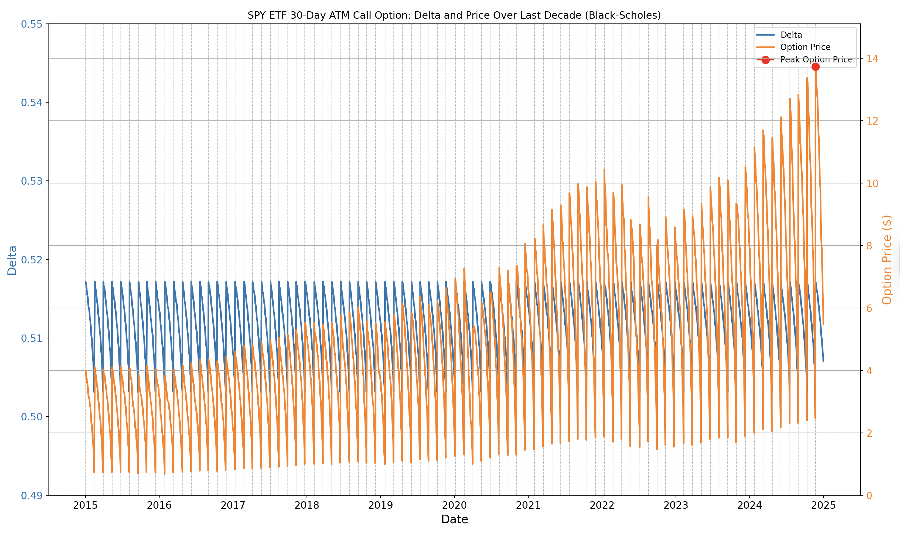

# Options Analytics & Black-Scholes Visualization

## Overview

this project models and visualizes the behavior of rolling **30-day at-the-money (ATM) call options** on the SPY ETF using the black-scholes pricing formula. it combines historical market data from yahoo finance with theory to show how option sensitivity (Delta) and theoretical price evolve over time.

by plotting these dynamics, I explored how **delta** of the **greeks** change with parameters time to expiry, underlying price, and volatility — important concepts in options trading and quant finance.

---

## Tools & Libraries

- `NumPy`, `pandas`: for modeling and data processing  
- `matplotlib`: for dual-axis time-series visualization  
- `yfinance`: to fetch SPY historical market data  
- black-scholes model: for theoretical option pricing and Delta calculation  

---

## Project Demonstrations

- **delta decay**: The sensitivity of an option to its underlying asset changes as expiry approaches.  
- **moneyness shifts**: As SPY’s price fluctuates, options drift between in-the-money and out-of-the-money, affecting both price and Delta.  
- **rolling expiries**: Simulating 30-day rolling options mimics the lifecycle of short-term positions often used by traders.  

the graph above visualizes these insights together — offering a clear, data-driven window into how an option “breathes” with the market.

**Graph Insight**:  
the plot reveals that while delta remains **relatively stable around 0.51**, the option price **steadily increases** alongside SPY. This demonstrates how option prices can grow despite minimal changes in delta, which emphasizes the role of underlying price trends and time decay in shaping value.

---

## Project Purpose

understanding how options behave over time is foundational for building **risk-managed strategies**, whether for hedging or speculation. this project sets the stage for a future goal: building and backtesting complete strategies using Python.
